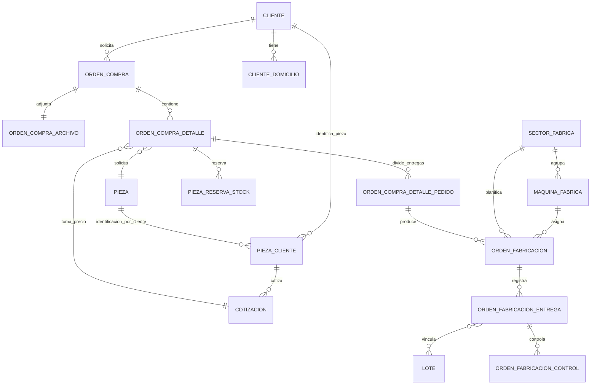

# Órdenes de Compra y Órdenes de Fabricación

## Alcance y fuentes

Esta página resume el modelo JPA y los flujos de negocio observados en `nitro-api`. «OC» significa Orden de Compra y «OF» Orden de Fabricación. Las entidades extienden `AuditableEntity<Long>` del framework, por lo que también heredan datos de auditoría que no están declarados en estas clases.

Fuentes principales:

- Entidades: [`domain/entities/fabricacion`](../nitro-api/src/main/java/ar/com/avaco/nitrophyl/domain/entities/fabricacion/)
- Alta y edición de OC: [`OrdenCompraEPServiceImpl`](../nitro-api/src/main/java/ar/com/avaco/nitrophyl/epservice/OrdenCompraEPServiceImpl.java)
- Generación y planificación de OF: [`OrdenFabricacionServiceImpl`](../nitro-api/src/main/java/ar/com/avaco/nitrophyl/service/fabricacion/OrdenFabricacionServiceImpl.java) y [`OrdenFabricacionEPServiceImpl`](../nitro-api/src/main/java/ar/com/avaco/nitrophyl/epservice/OrdenFabricacionEPServiceImpl.java)
- Registro de entregas: [`OrdenFabricacionEntregaEPServiceImpl`](../nitro-api/src/main/java/ar/com/avaco/nitrophyl/epservice/OrdenFabricacionEntregaEPServiceImpl.java)
- Identificación de pieza por cliente en la interfaz web: [`PiezaCliente`](../../nitrophyl-web/src/app/modules/abm/abm-piezas/models/pieza.model.ts) y [formulario de asociación pieza–cliente](../../nitrophyl-web/src/app/modules/abm/abm-piezas/components/clientes/modal/abm-pieza-cliente-modal.component.html)

## Mapa del dominio



El vínculo entre OC y OF es indirecto:

```text
OrdenCompra
  └─ detalle: Set<OrdenCompraDetalle>
       ├─ pieza: Pieza
       ├─ cotizacion: Cotizacion → PiezaCliente → Cliente + Pieza
       ├─ entregasSolicitadas: Set<OrdenCompraDetallePedido>
       │    └─ OrdenFabricacion.ordenCompraDetallePedido
       │         └─ entregas: Set<OrdenFabricacionEntrega>
       │              ├─ lotes: Set<Lote>
       │              └─ OrdenFabricacionControl (relación entrante)
       └─ reservas: Set<PiezaReservaStock>
```

La cardinalidad `1..` en el diagrama refleja el flujo de creación habitual (una OC tiene detalles y cada detalle recibe pedidos de entrega), no todas las restricciones que garantiza la base. Las anotaciones JPA de las entidades no imponen por sí solas que una OC tenga al menos un detalle o que un detalle tenga pedidos.

## Orden de Compra

Entidad y tabla: `OrdenCompra` → `ORDEN_COMPRA`.

### Datos propios

- `cliente` obligatorio; referencia al cliente que solicita la OC.
- `fecha`, `comprobante`, `estado` y `observaciones`.
- Datos de despacho: `tipoDespacho`, `empresaTransporte`, `mediosEnvio` y `domicilioEnvio`. Transporte y domicilio son opcionales en el mapeo.
- `archivo`: relación uno a uno con `OrdenCompraArchivo`. El archivo comparte el identificador de la OC (`@MapsId`); la relación en OC se declara `optional=false`, `EAGER` y con cascada completa. El binario `archivo` sí admite `null` en la columna.
- `detalle`: conjunto de líneas, con cascada completa, carga `EAGER` y `orphanRemoval=true`.

`TipoDespacho` tiene tres opciones: `RETIRO_CLIENTE`, `RETIRO_TRANSPORTE` y `ENVIO`. `mediosEnvio` se guarda como texto; el servicio de OC convierte la lista recibida a una cadena separada por comas y vuelve a dividirla al preparar el DTO.

### Detalle de OC

Entidad y tabla: `OrdenCompraDetalle` → `ORDEN_COMPRA_DETALLE`.

Cada línea referencia:

- La OC (`ordenCompra`) y una `Pieza`, ambas obligatorias.
- Una `Cotizacion`, obligatoria en el mapeo, con cascada `MERGE` y `PERSIST`.
- Cero o más `OrdenCompraDetallePedido` (en el modelo es un `Set` con cascada completa y `orphanRemoval=true`).
- Cero o más reservas de stock `PiezaReservaStock`; la relación inversa no declara cascada ni carga ansiosa.

La línea también guarda `descuento`, `observacionDescuento` y `observacion`. No declara el precio como campo propio: el valor y la fecha pertenecen a `Cotizacion`. El servicio de OF usa la cotización elegida para mostrar el valor y calcula el precio con descuento para la orden de trabajo.

### Relación pieza–cliente, código del cliente y cotización

La pieza tiene un `codigo` propio (`Pieza.codigo`), pero la relación `PiezaCliente` expresa además cómo identifica ese producto un cliente en particular. Una misma pieza de Nitrophyl puede tener códigos distintos para clientes distintos; por eso, al trabajar con una OC, la identificación específica del cliente se interpreta a través de la asociación que une la pieza y el cliente de esa orden, y no como el código global de `Pieza`.

La cadena desde una línea es `OrdenCompraDetalle.pieza` y `OrdenCompraDetalle.cotizacion → Cotizacion.piezaCliente → (Pieza, Cliente)`. La OC también referencia su `Cliente`. Para recuperar la identificación propia de ese cliente hay que usar la relación `PiezaCliente` correspondiente a esa misma pieza y a ese cliente; no alcanza con leer `Pieza.codigo` ni con tomar una relación de la pieza hacia cualquier otro cliente. `Cotizacion` contiene `valor`, `fecha` y `observaciones` y cuelga de esa relación pieza–cliente.

**Nombre del campo en la implementación:** el formulario web etiqueta este dato como **Código de Cliente**, pero lo enlaza a `nombrePiezaPersonalizado`; el DTO del formulario lo envía con ese nombre y el backend persiste ese atributo en `PiezaCliente` (`PIEZA_CLIENTE`). El usuario confirma que, en el negocio, ese campo cumple la función de código con el que el cliente identifica la pieza. El contrato TypeScript también declara `codigoCliente` en la interfaz `PiezaCliente`, aunque el formulario y el DTO Java usan `nombrePiezaPersonalizado`; al trabajar en este flujo, revisar esa diferencia de nombres y no confundirla con `Pieza.codigo`, que es el código interno/global.

Al crear o editar una OC, el servicio usa la cotización existente cuando llega `idCotizacion`. Si no, busca o crea la relación pieza–cliente y arma una cotización nueva con fecha y valor recibidos. La entidad `OrdenCompraDetalle` mantiene además una referencia directa a `Pieza`; el código no muestra una validación explícita de que la pieza de esa referencia coincida con la pieza de `Cotizacion.piezaCliente`.

### Entregas pedidas por el cliente

`OrdenCompraDetallePedido` → `ORDEN_COMPRA_DETALLE_PEDIDO` representa una fracción de una línea: cantidad solicitada y fecha de entrega solicitada. Es la unidad que conecta la venta con la fabricación.

El modelo no incluye un campo `cantidadTotal` en `OrdenCompraDetalle`; para una línea con entregas parciales, la cantidad se expresa en los pedidos asociados. La entidad tampoco valida que las cantidades de sus pedidos sumen un total acordado.

## Orden de Fabricación

Entidad y tabla: `OrdenFabricacion` → `ORDEN_FABRICACION`.

### Datos propios y asignación

- `numero` y `anio` forman una clave única conjunta; ambos son obligatorios e inmutables una vez insertados.
- `getNumeroOT()` presenta el identificador con el formato `NNN/AA` (número rellenado a tres dígitos y los dos últimos dígitos del año).
- `fecha`, `estado` y `posicion`.
- `ordenCompraDetallePedido` es obligatorio: cada OF referencia un pedido de entrega concreto.
- `sector`, `maquina` y `operario` son asignaciones a producción. Sector y máquina admiten `null` en la relación de OF. Una máquina, en cambio, siempre referencia un sector y tiene un tipo (`PRENSA`, `INYECTOR`, `EXTRUSORA` o `AUTOCLAVE`).
- `entregas`: conjunto de registros de entrega con carga `EAGER`. La relación no declara cascada.

El servicio de planificación agrupa/reordena OF por sector y, si se asignó, por máquina. La posición dentro de cada grupo es base uno. Al asignar una OF, el servicio la pone en `EN_PROCESO` y también cambia su OC a `EN_PROCESO`.

### Generación de OF desde OC

`OrdenFabricacionServiceImpl.generarOrdenes` recorre cada detalle de OC y cada pedido de entrega de ese detalle. Por cada pedido crea una OF con fecha actual, estado `PENDIENTE`, número secuencial para el año y referencia a ese pedido. En consecuencia, el flujo estándar genera una OF por entrega solicitada, no una OF única por línea ni una OF directamente por OC.

El servicio de OC puede invocar esta generación durante el guardado cuando `generarOrdenFabrica` es verdadero. En ese caso se inicializa la OC como `PENDIENTE`; si no se solicita fabricación, se inicializa como `INGRESADA`. Existe también una operación explícita `generarOrdenFabrica(idOC)` que genera las OF y pone la OC en `PENDIENTE`.

La entidad permite que varias OF apunten al mismo pedido de entrega (`ManyToOne` desde OF). El flujo estándar crea una por pedido, pero la entidad no declara una restricción única que impida duplicarlas.

### Entregas efectivamente fabricadas

`OrdenFabricacionEntrega` → `ORDEN_FABRICACION_ENTREGA` registra `cantidad`, `fecha`, OF y `operario` (obligatorios según anotación de relación). Cada registro puede asociarse a varios `Lote`, y cada lote puede estar presente en varias entregas, a través de `ORDEN_FABRICACION_ENTREGA_LOTE`.

Al registrar una entrega, el EP service suma la cantidad nueva con las entregas que la OF ya tiene. Si el total es igual a la cantidad pedida:

1. Marca la OF como `FINALIZADA`.
2. Comprueba si hay otras OF de la OC que sigan sin finalizar.
3. Marca la OC `FABRICADA` si ya no hay pendientes; si las hay, la deja `EN_PROCESO`.

Si el total aún no alcanza la cantidad solicitada, la OF queda `EN_PROCESO`. La comparación implementada es `total == cantidadSolicitada`; no se observó en ese método un control de exceso (`total > cantidadSolicitada`).

`OrdenFabricacionControl` → `ORDEN_FABRICACION_CHECK_CONTROL` referencia una entrega y guarda el texto de control y si fue aprobado. La entidad `OrdenFabricacionEntrega` no declara una colección inversa de controles.

## Estados observados

### OC (`EstadoOrdenCompra`)

Valores declarados: `INGRESADA`, `PENDIENTE`, `EN_PROCESO`, `FINALIZADA`, `FACTURADA`, `ENTREGADA`, `CANCELADA`, `FABRICADA`.

Flujos encontrados en los servicios revisados:

| Evento | Estado OC |
| --- | --- |
| Alta sin generar OF | `INGRESADA` |
| Alta/generación con OF | `PENDIENTE` |
| Asignar OF a sector/máquina | `EN_PROCESO` |
| Entregas de OF completan la cantidad, pero quedan otras OF pendientes | `EN_PROCESO` |
| Entregas completan la cantidad de todas las OF de la OC | `FABRICADA` |
| Cancelar OC | `CANCELADA`, solamente si estaba `PENDIENTE`; el motivo se guarda en `observaciones` |

Los valores `FINALIZADA`, `FACTURADA` y `ENTREGADA` existen en el enum, pero no se encontraron transiciones hacia ellos en los servicios revisados para este documento. Esto no demuestra que no haya otros flujos en otra parte del sistema.

### OF (`EstadoOrdenFabricacion`)

Valores declarados: `PENDIENTE`, `EN_PROCESO`, `FINALIZADA`.

El flujo observado crea OF como `PENDIENTE`, las pasa a `EN_PROCESO` al asignarlas o al registrar una entrega parcial y las finaliza al alcanzar la cantidad del pedido de entrega.

## Reservas de stock y dependencias

`PiezaReservaStock` guarda cantidad reservada, estado y fecha/hora de reserva, con referencia opcional a `OrdenCompraDetalle`. La relación expresa que una reserva se vincula a una línea de OC; `OrdenCompraDetalle.reservas` es la navegación inversa. No se encontró en los servicios revisados una regla que describa cómo se calcula la cantidad reservada o cómo cambia su estado.

El negocio de OC/OF también depende de datos de `Pieza` —denominación, código, fórmula, proceso, moldes, planos e insumos— al componer la orden de trabajo. Esos objetos no forman parte de la cadena de propiedad de la OC/OF: se consultan desde `OrdenCompraDetalle.pieza`.

## Consideraciones para cambios futuros

- Al analizar una OC, seguir `OC → detalle → pedido de entrega → OF`; no buscar una relación directa OC–OF.
- Una fecha/cantidad en `OrdenCompraDetallePedido` es el compromiso solicitado. Las entregas con fecha/cantidad están en `OrdenFabricacionEntrega` y los lotes se vinculan a esas entregas.
- La OC representa además despacho y datos comerciales; la OF representa planificación y ejecución de planta.
- Varias relaciones usan `EAGER`, mientras otras son `LAZY` o toman el valor por defecto de JPA. Tenerlo presente al serializar/consultar el grafo.
- No inferir transiciones de estado solo a partir del enum: documentar los métodos que efectivamente cambian cada estado.
